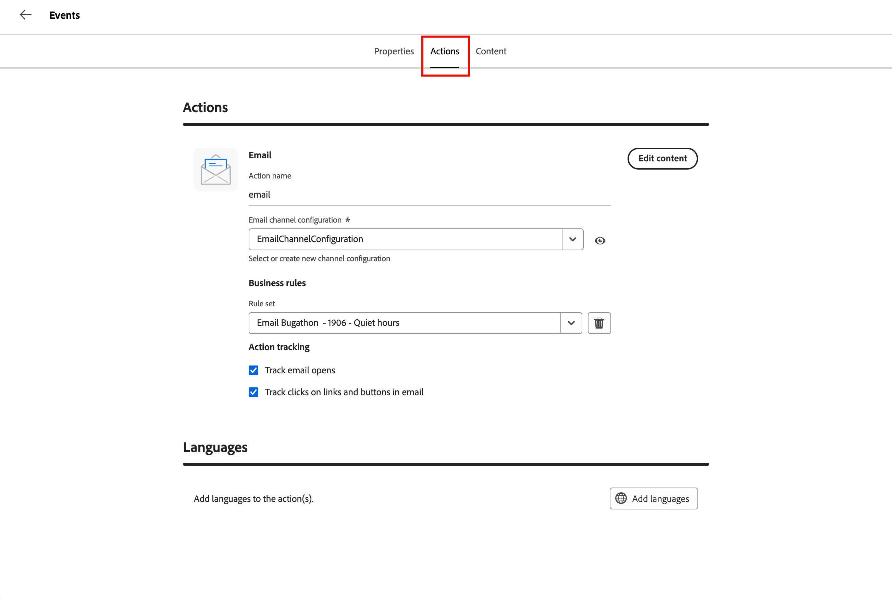

# Creación de correos electrónicos y adición a recorrido

[!DNL Adobe Marketo Optimizer] ofrece a los especialistas en marketing B2B una experiencia moderna de creación y entrega de correo electrónico de nivel empresarial, para que pueda crear, publicar y enviar correos electrónicos desde sus programas y recorridos.

Los correos electrónicos son recursos independientes, por lo que no necesita un recorrido para crear uno. [Crea un correo electrónico](#create-email-from-programs) dentro de un programa o una de sus carpetas, [publícalo](#publish-email) cuando esté listo y, a continuación, [envíalo desde cualquier recorrido de ese programa](#add-email-from-journey).

## Ciclo de correo electrónico {#lifecycle}

Un correo electrónico siempre tiene uno de los siguientes estados:

| Estado | Descripción |
| ----- | ----------- |
| **Borrador** | Cada nuevo correo electrónico comienza como borrador, que se muestra con un icono de sobre rojo en el árbol de programas. Puede editar sus propiedades, acciones y contenido, así como personalizarlo, analizarlo, cambiarle el nombre o eliminarlo. |
| **Publicado** | Un correo electrónico publicado está bloqueado y listo para enviarse, y se muestra con un icono de sobre verde. No se puede editar ni cancelar la publicación, y aparece en la lista cuando elige un correo electrónico en un recorrido. |
| **En un recorrido** | Cuando selecciona un correo electrónico publicado en una acción _Enviar correo electrónico_, se crea una copia publicada que pertenece al recorrido. La copia es de solo lectura y no cambia si el original se duplica y revisa posteriormente. |

Un correo electrónico pasa de borrador a publicado cuando se publica. Cuando se selecciona para un nodo de acción _Enviar correo electrónico_, una copia reside en el recorrido. Para cambiar un correo electrónico publicado, [duplíquelo](#duplicate-email). El duplicado se crea como borrador con el mismo contenido y configuración.

{width="800" zoomable="yes"}

El estado del correo electrónico determina la disponibilidad de la acción:

| Acción | Borrador | Publicadas | En un recorrido |
| ------ | ----- | --------- | ------------ |
| Editar propiedades, acciones y contenido | Sí | No | No |
| Personalizar correo electrónico | Sí | No | No |
| Analizar correo electrónico | Sí | No | No |
| Publicación | Sí, una vez resueltas las alertas de bloqueo | Ya publicado | Publicado automáticamente |
| Duplicado | Sí | Sí | No |
| Cambiar nombre | Sí | No | No. Asigne un nombre a la copia cuando la seleccione. |
| Eliminar | Sí | No | No. Elimine el nodo _Enviar correo electrónico_ en su lugar. |
| Seleccionar en un recorrido | No | Sí | No aplicable |

## Prerrequisitos {#before-you-begin}

Asegúrese de que la función de usuario incluya los siguientes [permisos de productos](../start/permissions-reference.md) para las tareas que realice:

* **[!UICONTROL Ver programas B2B]** y **[!UICONTROL Ver carpetas B2B]** - Ver los programas y carpetas donde residen los correos electrónicos.
* **[!UICONTROL Ver correos electrónicos B2B]** - Ver mensajes de correo electrónico.
* **[!UICONTROL Administrar correos electrónicos B2B]** - Crear, editar, duplicar, cambiar el nombre, eliminar y publicar correos electrónicos.
* **[!UICONTROL Administrar Recorridos de persona B2B]** - Agregar o reemplazar acciones de correo electrónico en un recorrido de persona. Para obtener acceso de solo lectura a los recorridos, use **[!UICONTROL Ver Recorridos de persona B2B]**.
* **[!UICONTROL Administrar experiencia de conversación B2B]** - Acceso [!DNL Coworker] para personalizar o analizar un correo electrónico. Las acciones de [!DNL Coworker] también requieren los permisos de correo electrónico correspondientes.

Solo se requieren permisos adicionales si realiza estas tareas de configuración o envío relacionadas:

* **[!UICONTROL Administrar programas B2B]** - Crear un programa si aún no existe uno.
* **[!UICONTROL Administrar configuraciones de canales B2B]** y **[!UICONTROL Ver configuración de correo electrónico B2B]**: cree una configuración de canal de correo electrónico. Los administradores también necesitan **[!UICONTROL Administrar configuración de correo electrónico B2B]** para configurar las opciones de envío de correo electrónico.
* **[!UICONTROL Publicar Recorridos de persona B2B]**: publique el recorrido que envía el correo electrónico.

Antes de crear un correo electrónico, confirme lo siguiente:

* Los correos electrónicos residen en un programa o en una de sus carpetas. Defina el programa antes de crear un correo electrónico. Un recorrido solo puede enviar correos electrónicos desde su propio programa.
* Para seleccionar una configuración de canal de correo electrónico, usa la pestaña **[!UICONTROL Acciones]** del correo electrónico. Los administradores administran [la configuración del canal de correo electrónico](../admin/email-channel-configuration.md).
* Puede crear tantos correos electrónicos como necesite dentro de un programa.

>[!NOTE]
>
>Si envía un correo electrónico por primera vez, asegúrese de que [capacidad de entrega de correo electrónico](../start/email-deliverability.md) y el [canal de correo electrónico](../admin/email-channel-configuration.md) necesario estén configurados.

<!-- 
* **Email channel configurations** - Manage the sender identity, reply behavior, marketing vs. transactional message types, and tracking.
* **Email deliverability controls** - Set up your email deliverability channel, including subdomain delegation (Fully Delegated and CNAME methods), DMARC, SPF/DKIM auto-configuration, and shared IP pool support.
* **Send Email action** - From a journey, add a _Send email_ action node, including personalization using profile attributes (Handlebars syntax).
* **Visual drag-and-drop email design tools** -  Design your email content with structures, content components, themes, dark-mode support, and reusable visual fragments.
* **Marketo Design Studio assets** — Choose images and assets from a one-time copy of your Marketo Engage asset library directly inside the email canvas.
* **Reusable templates and fragments** — Save common headers, footers, CTAs, and full email layouts and reuse them across journeys.
* **Role-Based Access Control (RBAC)** — Apply granular permissions for creating, editing, approving, and sending email. 
-->

>[!BEGINSHADEBOX]

## Limitaciones actuales {#limitations}

* **Los perfiles de prueba, Simular contenido y Enviar prueba** no están disponibles en la versión actual. Los informes de procesamiento Litmus y spam basado en SpamAssassin están planificados para una versión futura.
* **La personalización de nivel de cuenta y los datos de objeto personalizado** no están disponibles en la versión actual. Utilice atributos de perfil.
* **La migración automatizada de Velocity-to-Handlebars** de las plantillas existentes [!DNL Marketo Engage] está disponible bajo solicitud.
* **Los comentarios de correo electrónico y la colaboración** (comentarios en línea, @mentions, flujo de trabajo de solicitud y revisión) están planificados para una versión futura.
* **Las integraciones de AEM Assets, fragmentos de contenido de AEM y Adobe Express** están planificadas para una versión futura.

>[!ENDSHADEBOX]

## Conceptos clave {#key-concepts}

Antes de crear correos electrónicos para recorridos de personas y contenido de correo electrónico, revise estos conceptos:

| Concepto | En [!DNL Adobe Marketo Optimizer] |
| ------- | ---------------------- |
| **_[Espacio de diseño de correo electrónico](../content/email-authoring.md#email-design-tools)_** | El lienzo visual y las herramientas de diseño utilizadas para componer el contenido del correo electrónico. Incluye componentes de diseño de arrastrar y soltar, plantillas, fragmentos, temáticas y un editor de personalización. |
| **_[Plantilla](../content/templates.md)_** | Diseño de correo electrónico reutilizable disponible para crear un nuevo correo electrónico. Puede ser una plantilla de ejemplo integrada proporcionada por Adobe o una plantilla personalizada creada por su equipo. |
| **_[Fragmento visual](../content/fragments.md)_** | Bloque de contenido reutilizable (como encabezado, pie de página, CTA, exención de responsabilidad legal) que se puede insertar en varios correos electrónicos. La actualización de un fragmento propaga el cambio a cada correo electrónico que lo utiliza. |
| **_[Tema](../content/email-authoring.md#design-from-scratch)_** | Un ajuste preestablecido de estilo reutilizable (colores, tipografía, espaciado, estilos de botón) aplicado en un correo electrónico. |
| **_[Token de Personalization](../content/personalization-expressions.md)_** | Una expresión Handlebars, por ejemplo, `{{profile.firstName}}`, se resuelve en el momento del envío con los datos de perfil de cada destinatario. |
| **_[Correo electrónico independiente](#lifecycle)_** | Un recurso de correo electrónico que existe independientemente de cualquier recorrido. Se crea en un programa o en una de sus carpetas y pasa de borrador a publicado. |
| **_[Tipo de correo electrónico](#email-types)_** | La clasificación que elija al crear un correo electrónico, **[!UICONTROL Marketing]** o **[!UICONTROL Transaccional]**. Indica a [!DNL Marketo Optimizer] cómo tratar el mensaje con fines de consentimiento. |
| **_[Enviar acción por correo electrónico](./action-nodes.md#add-an-action-node)_** | Nodo de acción de recorrido que utiliza una configuración de canal y contenido de correo electrónico para enviar un correo electrónico. |

## Tipos de correo electrónico {#email-types}

Al crear un correo electrónico, elige su tipo. El tipo indica a [!DNL Marketo Optimizer] cómo tratar el mensaje con fines de consentimiento, así que elija el que coincida con el motivo por el que lo envía.

| Tipo | Usar para |
| ---- | ------- |
| **[!UICONTROL Marketing]** | Mensajes promocionales, como un anuncio de lanzamiento de producto, una newsletter o una invitación a un evento. |
| **[!UICONTROL Transaccional]** | Mensajes operativos que una persona espera debido a algo que hizo, como un pedido, un registro o una confirmación de envío. |

El tipo aparece como el correo electrónico **[!UICONTROL Categoría]** en la ficha **[!UICONTROL Propiedades]**.

## Creación de un correo electrónico en el árbol de programas {#create-email-from-programs}

Cree un correo electrónico en un programa o una carpeta para crearlo independientemente de cualquier recorrido.

1. En el panel de navegación izquierdo, expanda **[!UICONTROL Administración de mercadotecnia]** y seleccione **[!UICONTROL Programas]**.

1. En el árbol de programas, haga clic en el icono _Más_ (**...**) junto al programa o la carpeta donde desea crear el correo electrónico y seleccione **[!UICONTROL Crear correo electrónico]**.

   {width="400"}

1. En el cuadro de diálogo _[!UICONTROL Crear correo electrónico]_, complete los campos siguientes:

   * **[!UICONTROL Principal]** - (Obligatorio) El programa o la carpeta donde se guardó el correo electrónico. Se establece en el programa desde el que se inició y se puede cambiar a otro programa o a una de las carpetas del programa.

   * **[!UICONTROL Tipo de correo electrónico]** - Seleccione **[!UICONTROL Marketing]** o **[!UICONTROL Transaccional]** (consulte [Tipos de correo electrónico](#email-types)).

   * **[!UICONTROL Nombre]** - (Obligatorio) Escriba un nombre que identifique el correo electrónico en el árbol de programas.

   * **[!UICONTROL Descripción]** - (Opcional) Escriba una nota para su equipo acerca del correo electrónico y su propósito.

   {width="400"}

1. Haga clic en **[!UICONTROL Crear]**.

El correo electrónico se abre en su propia pestaña y aparece en el programa del árbol de programas como borrador. Mientras un correo electrónico esté abierto, cualquier [!DNL Coworker] mensaje se asigna a ese correo electrónico.

A continuación, [configure el correo electrónico](#define-email-properties), [resuelva las alertas](#alerts) y [publíquelo](#publish-email).

### Definir propiedades y acciones de correo electrónico {#define-email-properties}

Un correo electrónico de borrador tiene tres fichas: **[!UICONTROL Propiedades]**, **[!UICONTROL Acciones]** y **[!UICONTROL Contenido]**. Desplácese por ellos en orden y, a continuación, guarde los cambios. La página de correo electrónico se abre al crear un mensaje de correo electrónico en el árbol de programas. Para abrir un borrador más tarde, seleccione el correo electrónico en el árbol de programas.

#### Rellene las pestañas Propiedades y Acciones {#properties-actions-tabs}

1. (Opcional) En la pestaña **[!UICONTROL Propiedades]**, escriba una **[!UICONTROL Descripción]** y cualquier otra información descriptiva que desee capturar para el correo electrónico.

   {width="800" zoomable="yes"}

1. Seleccione la ficha **[!UICONTROL Acciones]** y complete la configuración funcional del correo electrónico:

   * **[!UICONTROL Correo electrónico]** - Seleccione o cree una **[!UICONTROL configuración de canal de correo electrónico]** para usar.

     Este es el conjunto reutilizable de configuraciones de envío de correo electrónico que define la identidad del remitente, la dirección de respuesta, el subdominio, el grupo de IP, el tipo de correo electrónico (de marketing o transaccional) y el seguimiento. Haga clic en el icono _Ver_ para revisar la configuración seleccionada.

     Los administradores crean configuraciones en [Configuración del canal de correo electrónico](../admin/email-channel-configuration.md).

   * **[!UICONTROL Reglas de negocios]**: (Opcional) aplique reglas de límite o de horas de inactividad a su acción de correo electrónico al seleccionar un conjunto de reglas.

     Para obtener más información sobre las reglas de negocio y cómo definir y activar conjuntos de reglas para las comunicaciones de canal, consulte [_Reglas de negocio_](../admin/business-rules.md).

   * **[!UICONTROL Seguimiento de acciones]**: seleccione las casillas de verificación de las acciones que desee rastrear para el correo electrónico.

   {width="600" zoomable="yes"}

#### Añadir la línea de asunto y el contenido {#content-tab}

1. Haga clic en **[!UICONTROL Editar contenido]** o seleccione la pestaña **[!UICONTROL Contenido]**.

   {width="500" zoomable="yes"}

1. Escriba el texto de **[!UICONTROL Línea de asunto]** que desee mostrar en el campo de asunto del correo electrónico.

   La línea de asunto es obligatoria.

   Haga clic en el icono _Personalizar_ (  ) para usar un token de personalización en el campo.

1. (Opcional) Seleccione la casilla de verificación **[!UICONTROL Optimizar tamaño de HTML]** para reducir el tamaño de su HTML de correo electrónico durante el proceso de publicación.

   Esto ayuda a evitar el recorte de correos electrónicos en clientes como Gmail. Gmail trunca los mensajes que superan los 100 KB. Consulte [_Optimizar el tamaño de HTML del correo electrónico_](#optimize-html-size) para obtener más información.

1. Haga clic en **[!UICONTROL Editar cuerpo del correo electrónico]** para acceder a las herramientas de diseño visual y comenzar a [crear su contenido](../content/email-authoring.md).

   También puede hacer clic en **[!UICONTROL Editor de código]** para codificar su propio contenido en HTML sin formato. Si tiene HTML existente para reutilizarlo en su diseño de correo electrónico, puede copiarlo y pegarlo en el editor.

### Comprobación de alertas {#alerts}

El botón **[!UICONTROL Alertas]** del encabezado del correo electrónico muestra cuántos problemas ha encontrado [!DNL Adobe Marketo Optimizer]. Haga clic en él para mostrar la lista.

{width="450"}

Las alertas se ofrecen de dos tipos:

* **Problemas de bloqueo**: mientras cualquiera de estos problemas permanezca, **[!UICONTROL Publicar]** no está disponible y el menú de _Más_ del correo electrónico muestra **[!UICONTROL Resolver alertas de correo electrónico para publicar]**. Resuelva todos los problemas de bloqueo antes de publicar el correo electrónico.

  Algunos ejemplos son:

  * El nombre de remitente está vacío
  * Falta la línea de asunto
  * El contenido del correo electrónico está vacío

* **Advertencias**: Estas advertencias indican cosas que vale la pena revisar, pero no impiden la publicación. Un correo electrónico puede mostrar una alerta y seguir publicándose si las alertas restantes son advertencias.

  Algunos ejemplos son:

  * El vínculo de no participación no está presente en el cuerpo del correo electrónico
  * La versión de texto de HTML está vacía
  * Vínculos vacíos detectados
  * El correo electrónico supera los 100 K

## Administración de correos electrónicos en el árbol de programas {#manage-emails}

Los correos electrónicos aparecen en el árbol de programas con un icono de sobre. Un sobre rojo marca un borrador. Un sobre verde marca un correo electrónico publicado. Haga clic en el icono _Más_ (**...**) junto a un correo electrónico para administrarlo.

{width="400"}

El menú de un borrador de correo electrónico incluye **[!UICONTROL Publicar]**, **[!UICONTROL Personalizar correo electrónico]**, **[!UICONTROL Analizar correo electrónico]**, **[!UICONTROL Duplicar]**, **[!UICONTROL Cambiar nombre]** y **[!UICONTROL Eliminar]**.

Para un correo electrónico publicado, **[!UICONTROL Duplicate]** es la única opción.

### Personalización y análisis de un correo electrónico {#personalize-analyze}

Mientras que un correo electrónico es un borrador, su menú _Más_ incluye dos herramientas de contenido. Ejecútelos antes de publicar, ya que un correo electrónico publicado no se puede cambiar.

* **[!UICONTROL Personalizar correo electrónico]** - Abre [!DNL Coworker] con el correo electrónico cargado. Para añadir contenido personalizado al correo electrónico, describa el grupo destinatario. Consulte [_Personalizar contenido de correo electrónico por persona_](../agents/personalize-content.md) para obtener más información.

  {width="700" zoomable="yes"}

* **[!UICONTROL Analizar correo electrónico]**: revisa el contenido que ya creó. Ver [Analizar un correo electrónico existente](../agents/personalize-content.md#analyze-existing-email).

### Publicación de un correo electrónico {#publish-email}

Publique un correo electrónico cuando esté listo para enviarlo. Solo se muestran los correos electrónicos publicados cuando [selecciona un correo electrónico en un recorrido](#add-email-from-journey).

1. Asegúrese de que el correo electrónico no tenga [alertas](#alerts) bloqueadas.

1. En el árbol de programas, haga clic en el icono _Más_ (**...**) junto al correo electrónico y seleccione **[!UICONTROL Publicar]**.

1. En el cuadro de diálogo de confirmación de _[!UICONTROL Publicar correo electrónico]_, haga clic en **[!UICONTROL Publicar]**.

   {width="400"}

El icono de correo electrónico se vuelve verde. Si selecciona el correo electrónico, se abrirá en una vista de solo lectura que resume su contenido, propiedades y acciones.

{width="700" zoomable="yes"}

>[!IMPORTANT]
>
>La publicación es permanente. Un correo electrónico publicado no se puede editar, cambiar de nombre, eliminar ni devolver a borrador. Para hacer cambios, [duplique el correo electrónico](#duplicate-email).

### Duplicación de un correo electrónico {#duplicate-email}

Para cambiar un correo electrónico publicado, debe duplicarlo. Para probar una variación sin cambiar el original, también puede duplicar un borrador.

1. En el árbol de programas, haga clic en el icono _Más_ (**...**) junto al correo electrónico y seleccione **[!UICONTROL Duplicar]**.

1. En el cuadro de diálogo _[!UICONTROL Duplicar correo electrónico]_, cambie el **[!UICONTROL Nombre]** si es necesario.

   De manera predeterminada, el nombre original va seguido de `_copy`. Opcionalmente, agregue **[!UICONTROL Descripción]**.

   {width="400"}

1. Haga clic en **[!UICONTROL Duplicar]**.

El duplicado se crea como borrador con el mismo contenido y configuración. Realice los cambios y, a continuación, publíquelo.

## Adición de un correo electrónico a un recorrido {#add-email-from-journey}

Para enviar un correo electrónico, añádalo a un recorrido del mismo programa. Cuando selecciona un correo electrónico, [!DNL Marketo Optimizer] hace una copia del mismo para ese recorrido y publica la copia automáticamente. Los correos electrónicos provienen del árbol de programas, por lo que [primero debe crear y publicar el correo electrónico](#create-email-from-programs).

Puede utilizar el mismo correo electrónico en más de un recorrido. Cada vez que la selecciona, se crea una copia independiente para ese recorrido y puede asignar a cada copia un nombre único.

### Seleccione un correo electrónico para una acción Enviar correo electrónico {#select-email-in-journey}

1. Abra el recorrido y seleccione o agregue un nodo [_Realizar una acción_](action-nodes.md#add-an-action-node).

1. En _[!UICONTROL Seleccionar acción]_, elija **[!UICONTROL Enviar correo electrónico]**.

1. En _[!UICONTROL Origen del correo electrónico]_, elija una de las siguientes opciones:

   * **[!UICONTROL Elegir un correo electrónico del árbol de programas]** - Elija esta opción para usar un correo electrónico publicado del programa del recorrido o de sus carpetas.

   * **[!UICONTROL Usar un correo electrónico personalizado con IA]**: elija esta opción para usar un correo electrónico generado por IA. Estos correos electrónicos están optimizados para que los clientes de la bandeja de entrada asistida por IA fundamenten sus resúmenes y respuestas en sus ofertas y llamadas a la acción.

   {width="600"}

   El nodo mostrará un nombre de correo electrónico en blanco hasta que seleccione un correo electrónico.

1. Haga clic en **[!UICONTROL Seleccionar correo electrónico]**.

   * **_Correo electrónico del árbol de programas:_** En el cuadro de diálogo _[!UICONTROL Seleccionar correo electrónico]_, busque y seleccione el correo electrónico.

     Use **[!UICONTROL Buscar correo electrónico]** para filtrar si es necesario. Seleccione un correo electrónico en la lista para previsualizarlo y marque la línea de asunto.

     {width="600" zoomable="yes"}

     >[!NOTE]
     >
     >El cuadro de diálogo solo enumera los correos electrónicos publicados del programa de recorrido y sus carpetas. Los borradores no aparecerán hasta que [los publique](#publish-email). Si no aparece un correo electrónico, compruebe que tenga un publicado (icono verde) y que esté ubicado en el programa correcto.

     En **[!UICONTROL Nombre]**, escriba el nombre que debe tener el correo electrónico dentro del recorrido.

     De manera predeterminada, el nombre original va seguido de `_copy`. Cambie el nombre por otro que tenga sentido en el contexto del recorrido.

   * **_correo electrónico personalizado con IA:_** En el cuadro de diálogo _[!UICONTROL Seleccionar un correo electrónico generado por IA]_, busque y seleccione el correo electrónico personalizado.

     Seleccione un correo electrónico personalizado de la lista. El cuadro de diálogo enumera _los correos electrónicos personalizados con IA_ almacenados en la biblioteca de IA. Para obtener más información, consulte Personalizar el contenido del correo electrónico por persona.

     {width="450" zoomable="yes"}

1. Haga clic en **[!UICONTROL Seleccionar]**.

### copia de correo electrónico de recorrido {#journey-copy}

La copia se añade al recorrido, se publica y se enumera en el recorrido del árbol de programas con un icono naranja. Tiene su propio ID de acción y es de solo lectura.

{width="700" zoomable="yes"}

El recorrido guarda su propia copia. El contenido y la configuración se copian en el momento en que selecciona el correo electrónico. Si posteriormente duplica y revisa el original, los recorridos existentes seguirán enviando la versión copiada.

Para la [optimización del tiempo de envío](email-send-time-optimization.md) opcional, configure el nodo de acción de recorrido después de seleccionar el correo electrónico.

### Actualización de un correo electrónico en un recorrido {#update-email-in-journey}

Como la copia del recorrido es de solo lectura, debe reemplazarla en lugar de editarla.

1. [Duplicar](#duplicate-email) el correo electrónico original publicado, realizar los cambios en el borrador y [publicarlo](#publish-email).

1. En el recorrido, seleccione el nodo _Enviar correo electrónico_ y elimínelo mediante el icono de papelera en el panel _Realizar una acción_.

1. Agregue una nueva acción _Enviar correo electrónico_ en su lugar y seleccione el correo electrónico actualizado.

## Optimizar tamaño de HTML de correo electrónico {#optimize-html-size}

>[!CONTEXTUALHELP]
>id="ajo-b2b-prime_email_minification"
>title="Reducir tamaño de HTML"
>abstract="Habilite esta opción para comprimir el HTML de correo electrónico durante la publicación eliminando los espacios en blanco innecesarios, la sangría y los comentarios no esenciales. Esto ayuda a evitar el recorte de correos electrónicos en clientes como Gmail. Gmail trunca los mensajes que superan los 100 KB."

[!DNL Marketo Optimizer] le permite comprimir su versión de HTML de correo electrónico durante el proceso de publicación al eliminar espacios en blanco, sangrías y comentarios no esenciales innecesarios. Mantener el tamaño pequeño de HTML le ayuda a lo siguiente:

* Evite **recortes de correo electrónico**: algunos clientes, como Gmail, truncan mensajes de más de ~100 KB, lo que impide que los destinatarios vean todo el contenido.
* Mejorar **tiempo de carga del correo electrónico** en la bandeja de entrada del destinatario.
* Mejore la capacidad de **entrega** y reduzca el uso del ancho de banda.

Esta optimización no se aplica automáticamente; debe habilitarla en la ficha _[!UICONTROL Contenido]_.

<!--  -->

>[!IMPORTANT]
>
> La reducción del tamaño de la HTML solo se aplica en el momento de la publicación.

La optimización es segura para el cliente de correo electrónico:

* Conserva los comentarios condicionales de MSO/Outlook.
* No altera el contenido, las imágenes ni los vídeos reales.

>[!NOTE]
>
>La reducción del tamaño del correo electrónico depende de la estructura original de HTML del correo electrónico. Si el contenido ya es compacto o la carga útil del correo electrónico es muy grande, la reducción puede ser mínima y no evitar por completo el recorte.

<!-- 
Proof and simulate workflows are not available in this release. See [Current limitations](#limitations).

### Test HTML size optimization {#optimize-html-proof}

If you have enabled the [HTML size optimization](#optimize-html-size) option, you can evaluate its impact before publishing when sending proofs. Follow the following steps.

1. In the email design space, click the _Issues_ icon on the top right. If the rendered email size exceeds 100 KB, a message is displayed to warn you that this may cause truncation in some email clients.

1. Click **[!UICONTROL Simulate content]**.

1. To test the optimized version, click the **[!UICONTROL Send proof]** button and select the **[!UICONTROL Optimize HTML size]** option. This will send a proof with the reduced HTML size to your test recipients.

    >[!NOTE]
    >
    >This setting is independent from the email editor — the proof reflects what you select in the proof, regardless of whether the option is enabled or disabled in the email itself.

1. Select the test recipients and click **[!UICONTROL Send proof]**.

1. Back in the **[!UICONTROL Simulate]** screen, click the **[!UICONTROL View Proof]** button.

1. Click the _Information_ icon next to the status of the proof.

   The optimization details are displayed in a pop-up window, including the original HTML size, the optimized HTML size, and the size reduction percentage.
    
    Use this information to validate the optimized output and confirm the email stays within the recommended 100 KB threshold before publishing.

-->
