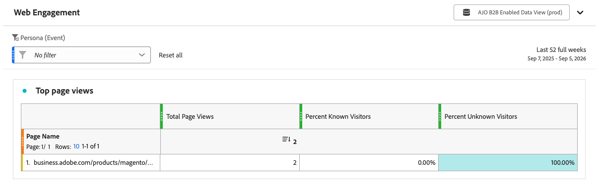
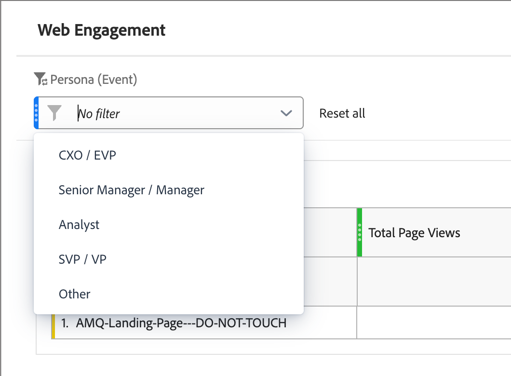

# Informe Participación en la web

<!-- SPHR-39571: Audience, Company Name, Company Industry, and Region filters, plus the report title/subtitle rename, are planned under SPHR-32471 (not yet shipped) and should be documented separately once delivered  -->

Use el informe [!UICONTROL Participación en la web] para revisar la participación de los seminarios web interactivos más populares en toda la instancia.

_Para ver el informe :_

1. En el panel de navegación izquierdo, seleccione **[!UICONTROL Informes]**.
1. Haga clic en el icono _Lista_ (  ) y seleccione **[!UICONTROL Participación web]** en el panel _[!UICONTROL Tabla de contenido]_.

{width="700" zoomable="yes"}

Puede [cambiar el intervalo de fecha](./reports-overview.md#change-the-date-range) para el informe.

Seleccione **[!UICONTROL Compartir]** en la parte superior del informe para descargar o programar una exportación de todos los datos del informe. Consulte [_Exportar un informe_](./reports-overview.md#export-a-report) en la descripción general de informes.

## Tabla del informe {#report-table}

El informe [!UICONTROL Participación en la web] muestra las 10 páginas más vistas de su instancia, con la siguiente dimensión de fila.

* **[!UICONTROL Nombre de página]** - El nombre de la página web.

| Columna | Descripción |
| --- | --- |
| [!UICONTROL Vistas de página totales] | Número total de vistas de la página. |
| [!UICONTROL Porcentaje de visitantes conocidos] | Porcentaje de vistas de visitantes conocidos. |
| [!UICONTROL Porcentaje de visitantes desconocidos] | Porcentaje de vistas de visitantes desconocidos. |

## Filtros {#filters}

Use el filtro **[!UICONTROL Persona (evento)]** en la parte superior del informe para reducir los datos de vista de página. Abra la lista de filtros y seleccione los valores que desea incluir.

* **[!UICONTROL Persona (evento)]** - Filtrado por el [personaje derivado](../audiences/personas.md#filter-by-derived-persona) asociado con las vistas de página. El valor predeterminado es [!UICONTROL Sin filtro].

{width="500" zoomable="yes"}

Seleccione **[!UICONTROL Restablecer todo]** para borrar el filtro y volver a la vista predeterminada.

>[!NOTE]
>
>Los filtros para audiencia, nombre de la empresa, sector y región están planificados para una versión futura.
